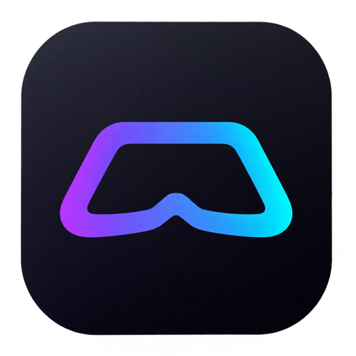

# .NET Cockpit

<p align="center">
  
</p>

<p align="center">A local cockpit for your .NET installation.</p>

<p align="center">
  <a href="https://capjan.github.io/dotnet-cockpit/">Documentation</a>
  ·
  <a href="LICENSE">MIT License</a>
</p>

`.NET Cockpit` opens a local browser workspace for the .NET installation on your machine. It lists SDKs, runtimes, global and local tools, and helps you keep track of what is available — all on `127.0.0.1`.

## Install

Requires the .NET 10 SDK:

```sh
dotnet tool install --global dotnet-cockpit
dotnet cockpit
```

To update later:

```sh
dotnet tool update --global dotnet-cockpit
```

The app opens in your browser automatically. To keep it in the terminal or choose a port:

```sh
dotnet cockpit --no-browser --port 5230
```

## What it does

- Shows the SDKs and runtimes visible to the active `dotnet` host.
- Lists global tools and local tool manifests for the directory you start it from.
- Provides server-rendered filtering, sorting, setup help, and safe local tool actions.

The core interface works without JavaScript. Browser assets are bundled locally; no CDN requests are made.

## No .NET installed?

Download the self-contained native executable for Windows, Linux, or macOS from the [GitHub releases](https://github.com/capjan/dotnet-cockpit/releases). It includes the .NET runtime and opens the same local application.

## Development

```sh
npm --prefix ui ci
npm --prefix ui run build
dotnet test DotnetCockpit.sln
dotnet run --project src/DotnetCockpit -- --no-browser --port 5230
```

See the [documentation](https://capjan.github.io/dotnet-cockpit/) for features, development details, and the release process.
